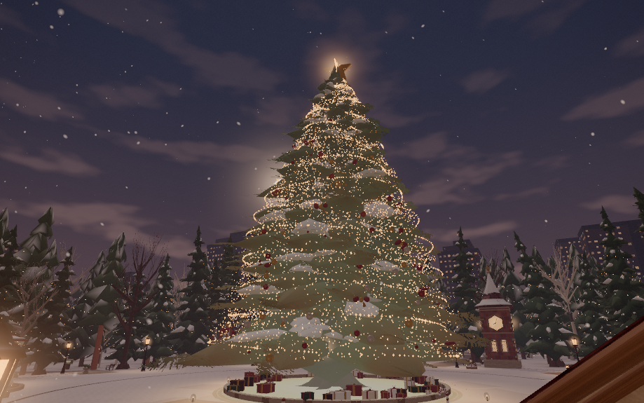
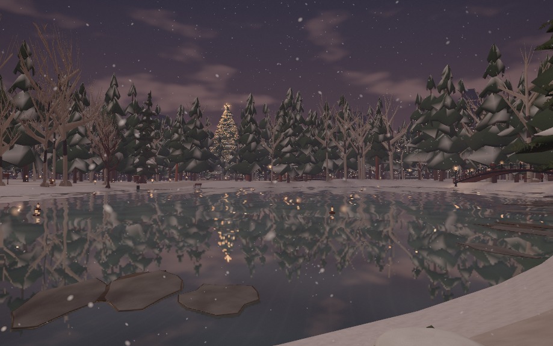
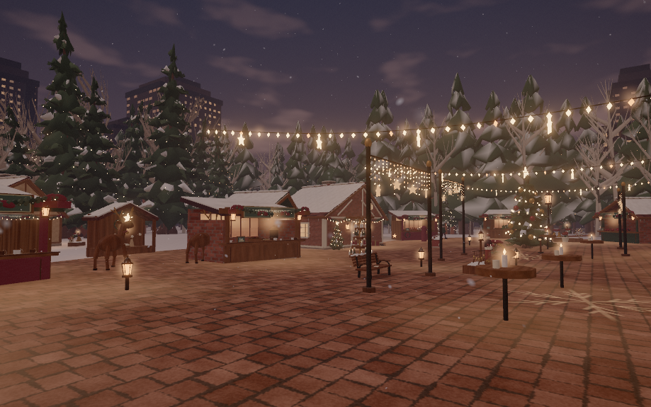
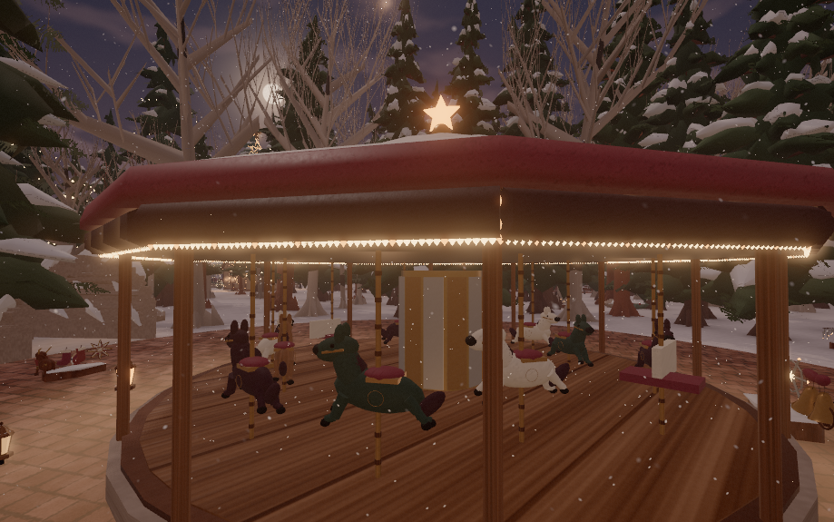
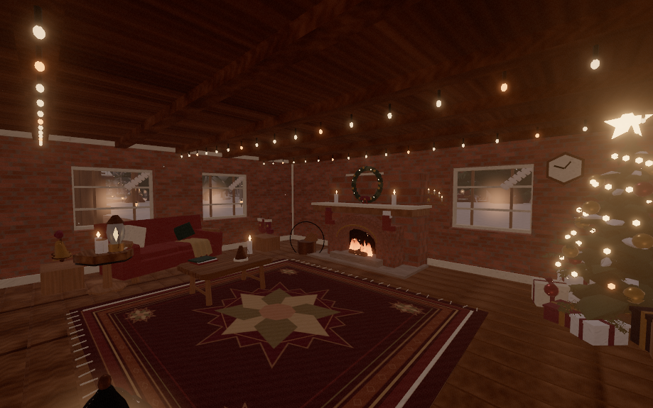

<div align="center">

# Afterglow Park · 晚霞燈園

**晚霞未散，燈火已暖。**<br>
*Sunset lingers, and the lights glow warm.*<br>
夕あかりが残る街に、あたたかな灯りがともる。

### [▶ 進入公園 Play now](https://oxayuanxo.github.io/Afterglow-Park/)

`https://oxayuanxo.github.io/Afterglow-Park/`



[中文](#中文) · [English](#english) · [日本語](#日本語) · [操作 Controls](#操作指南--controls) · [本機開發](#本機開發)

</div>

---

## 中文

最後一抹晚霞落在城市的天際線，公園裡的燈也一盞盞亮了起來。琥珀色的光映著細雪與松枝，中央廣場的聖誕樹在暮色裡靜靜閃耀。

**晚霞燈園**是藏在城市裡的聖誕公園。從湖畔長椅走到聖誕市集，再到松間的旋轉木馬，讓黃昏與暖光陪你，把這一晚慢慢走完。

這是一個在瀏覽器裡即時渲染的 3D 風景氛圍模擬器：沒有任務、分數，也沒有時間限制。世界、裝飾與小屋家具全部由程式生成；音樂與環境音由 Web Audio 即時合成。你可以散步、坐下、拍照，或只是看雪。

## English

As the last of the sunset melts into the city skyline, the park's lights come on one by one. Amber light drifts through falling snow and pine branches, and the tree in the central plaza glows quietly.

**Afterglow Park** is a Christmas park tucked into the heart of the city. Wander from the lakeside bench to the holiday market, then on to the carousel among the pines, and let the dusk and the warm light set the pace of your evening.

It is a real-time 3D ambience simulator that runs entirely in your browser — no quests, no score, no timer. The world, decorations and cabin furniture are procedurally generated, and the music and soundscape are synthesised live with Web Audio. Walk, sit, take photos, or simply watch the snow.

## 日本語

最後の夕焼けが街のスカイラインに溶けるころ、公園の灯りがひとつ、またひとつとともりはじめます。琥珀色の光が粉雪と松の枝をやわらかく照らし、中央広場のツリーが静かに輝いています。

**夕あかりパーク**は、街の中にひっそりと息づくクリスマスの公園。湖畔のベンチからクリスマスマーケット、松林の回転木馬へ。黄昏とぬくもりの光に包まれて、この夜をゆっくり歩いてみませんか。

ブラウザだけで動くリアルタイム 3D の風景シミュレーターです。クエストもスコアも制限時間もありません。散歩して、ベンチに座って、写真を撮って、ただ雪を眺めてください。

---

## 園區一覽 · Around the Park

| | |
|:-:|:-:|
| <br>**鏡雪池塘** Mirrorwater Pond<br><sub>湖畔長椅、木橋與船屋</sub> | <br>**聖誕市集** Holly Market<br><sub>熱可可、烤栗子與薑餅攤</sub> |
| <br>**松間旋轉木馬** Pinewood Carousel<br><sub>按 E 選一匹木馬坐上去</sub> | <br>**壁爐小屋** By the Hearth<br><sub>開門、點爐火、聽音樂盒</sub> |

其他角落：聖誕林蔭大道、戶外溜冰場、古典花園與隱密花園、暮光觀景台、燈籠林小徑、樹冠步道、營火空地……
全部 12 個鏡位見 [截圖索引](screenshots/README.md)；地點座標（含劇透）見 [POI_LIST](docs/POI_LIST.md)。

### 第一次散步 · A first walk

從南門沿燈串一路向北，穿過拱門就會看見中央的大雪杉。往西是池塘與原木小屋；往東北是市集，再沿北側小路可找到紅磚壁爐小屋；東南的松林裡，旋轉木馬旁的紙袋燈會帶你走上樹冠板道。

> 想讓天色更接近「晚霞」？按 **Tab** 打開氛圍面板，把時間切到 **傍晚藍調**。

---

## 操作指南 · Controls

建議使用**桌上型瀏覽器 + 鍵盤滑鼠**，並開啟硬體加速。載入完成後按「**進入公園**」開始（同時解鎖瀏覽器音訊，戴耳機效果更好）。

| 場合 | 操作 |
|---|---|
| 入口 | **進入公園**播放降落到南門的短運鏡；**Esc** 或「跳過」直接開始。下方園區選景可切換即時視角。 |
| 第一人稱 | **W A S D**／方向鍵移動，**Shift** 慢跑。點一下場景鎖定滑鼠轉動視線（未鎖定時按住左鍵拖曳）。**E** 互動，**Esc** 解鎖／暫停。 |
| 自由視角 | **V** 切換；**WASD** 平移、**Q**／**E** 降升、**Shift** 加速；左鍵旋轉、右鍵平移、滾輪推拉。 |
| 長椅與小屋 | 面對長椅／沙發按 **E** 坐下，移動鍵或 **Esc** 起身。按 **E** 開門；爐火、桌燈、彩燈與音樂盒可分別操作。 |
| 活動 | 旋轉木馬入口按 **E** 選座；向溜冰亭借冰鞋上冰；對指定雲杉按 **E** 搖落雪粉；在鬆雪區按 **Z** 躺下看天空。 |
| 氛圍 | **Tab**：降雪、風、時間、燈光、音量、畫質、FOV、後製；「獨處」可隱藏行人與市集低語。 |
| 地圖與手札 | **M**：方向、區域、造訪痕跡；已到訪區域可「前往」。 |
| 照片 | **P**：自由構圖或 12 個鏡位，調曝光、色溫、景深、暗角，下載 PNG。 |
| 電影巡遊 | **C** 進入／退出；移動或點擊即可接手。 |
| 介面 | **H** 隱藏／顯示 UI。 |

| Situation | Keys |
|---|---|
| Walk | **WASD** / arrows · **Shift** jog · click to lock mouse · **E** interact · **Esc** pause |
| Views | **V** free camera · **C** cinematic tour · **P** photo mode · **M** map · **Tab** mood panel · **H** hide UI |

### 網址參數 · URL parameters

| 參數 | 用途 |
|---|---|
| `?backend=webgl&quality=low` | 畫面異常或效能不足時，強制 WebGL 2 低畫質 |
| `?quality=low｜medium｜high｜ultra` | 指定畫質檔位（預設自動） |
| `?debug` | 顯示實際後端與渲染統計 |

例：<https://oxayuanxo.github.io/Afterglow-Park/?backend=webgl&quality=low>

預設會先嘗試 **WebGPU**，不支援時自動退回 **WebGL 2**。手札與設定只保存在本機瀏覽器的 `localStorage`。

---

## 本機開發

需要 Node.js **22.12+**（或 20.19+）。

```bash
npm install
npm run dev          # http://localhost:5173
npm run build        # 輸出 dist/
npm run preview      # http://localhost:4173 預覽正式建置
npm run test:unit    # 單元測試
```

`dist/` 可放到任何靜態 HTTP 伺服器（不要用 `file://` 開啟）；`vite.config.js` 使用相對路徑 `base: './'`，所以放在子路徑下也能運作。沒有外部 API、帳號或 CDN。

瀏覽器測試（需先 `npx playwright install chromium`，並讓 dev／preview 伺服器保持運作）：

```bash
npm test                                   # smoke 測試（預設 localhost:5173、強制 WebGL 2）
PARK_URL=http://localhost:4173/ node scripts/pages-check.mjs   # 入口、字體與進園截圖
npm run shots                              # 12 鏡位 × 四檔畫質截圖
```

更多驗證指令見 [QA_RUNBOOK](docs/QA_RUNBOOK.md)。

### 部署 · Deployment

推送到 `main` 時，[`.github/workflows/pages.yml`](.github/workflows/pages.yml) 會自動：

1. `npm ci` → 單元測試 → `npm run build`
2. 把 `dist/` 上傳並發布到 **GitHub Pages**
3. 另以 Playwright + SwiftShader 實際開啟建置版並截圖（artifact：`pages-check`，不阻擋部署）

首次使用請確認 **Settings → Pages → Source** 設為 **GitHub Actions**。

### 專案結構

```
index.html            入口頁
src/                  場景、地形、植被、建築、燈光、音訊、UI（Three.js）
  data/               園區配置、地點、活動與文案資料
public/               字體、授權文件、入口預覽圖
scripts/              測試、截圖與驗證腳本（Playwright / Node）
docs/                 架構、效能、驗收、已知問題與實測紀錄
screenshots/          實際渲染截圖
```

### 技術

[Three.js](https://threejs.org/) 0.187（WebGPU／WebGL 2 渲染、TSL 後製）· [Vite](https://vite.dev/) 8 · Web Audio API · [Playwright](https://playwright.dev/)

### 文件

[架構與資料欄位](docs/ARCHITECTURE.md) · [效能與瀏覽器驗證](docs/PERF_NOTES.md) · [驗收對照](docs/ACCEPTANCE.md) · [測試重現](docs/QA_RUNBOOK.md) · [已知問題](docs/KNOWN_ISSUES.md) · [視覺檢視](docs/VISUAL_REVIEW.md) · [發布報告](docs/RELEASE_REPORT.md)

---

## 來源與授權

本專案以 **Winter Wonderland 0.10**（雪夜都市森林公園模擬器）為基礎，改名為 Afterglow Park 並加上入口文案與 GitHub Pages 部署。園內招牌、導覽牌上的「WINTER GARDENS」是原作的園區名稱，所以仍保留。

- 字體：Cormorant Garamond、Noto Sans TC（SIL OFL 1.1，授權文件在 `public/fonts/`）
- 旋律：公版傳統聖誕曲調，用 Web Audio 重新編排合成，沒有使用任何錄音採樣
- 函式庫：Three.js（MIT）、Vite（MIT）、Playwright（Apache-2.0）

完整清單見 [CREDITS.md](CREDITS.md)。

<div align="center"><sub>晚霞未散，燈火已暖。 · Sunset lingers, and the lights glow warm. · 夕あかりが残る街に、あたたかな灯りがともる。</sub></div>
